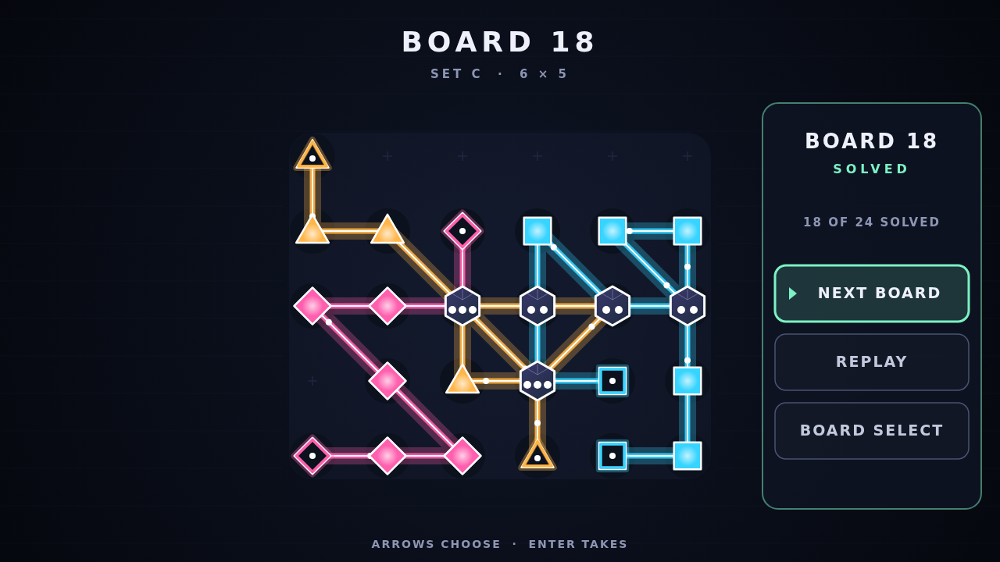

# Refract

Refract is a puzzle of light drawn across a dark optical bench. Every board is a
lattice of glowing nodes, and every colour of light on it is a channel with two
emitters waiting to be joined. You don't fire the light — you draw it. Press on
an emitter and trace from node to node, and the beam follows your finger or
your mouse, quietly refusing any move the rules won't allow.

A beam is finished when it runs from one of its emitters to the other and
threads every lens of its own colour and shape. Beams step to any of the eight
nodes around them, diagonals included, but they never touch another channel's
nodes, never share a link, and never cross. In the middle of it all sit the
crystals: they belong to no colour, any beam may pass through one, and every
charge a crystal holds has to be spent — no more, no fewer. Light every channel
and spend every crystal, and the board is solved.

The **Campaign** is a hand-built course of twenty-four boards in four sets,
from small single-colour warm-ups to crowded seven-by-six benches where three
channels fight over the same crystals. Each solve unlocks the next board, and
any board you've reached can be replayed.

**Cascade** never ends. It deals you freshly generated boards, one after
another, climbing a five-rung ladder as you solve them: wider grids, a second
and then a third channel, and more and more crystals shared between them. Every
board it hands you has an answer — and more than one way to reach it.

Refract plays with a mouse, a pen, or a fingertip, and every menu works from
the keyboard as well.
